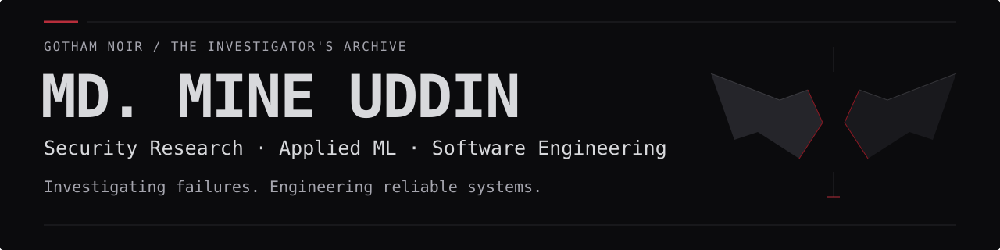

<picture>
  <source media="(prefers-color-scheme: dark)" srcset="assets/gotham-banner-dark.svg">
  <source media="(prefers-color-scheme: light)" srcset="assets/gotham-banner-light.svg">
  
</picture>

I’m a final-year Computer Science and Engineering student at **United International University**, Dhaka, Bangladesh, graduating in **February 2027**. I investigate failures in APIs, software supply chains and edge systems, and build practical applications around what people need. My focus is cybersecurity, applied machine learning and dependable software.

## Active investigations

### Layer by Layer: An Empirical Ablation of Replay Defenses in a Signed Banking API

*Co-Lead Researcher · API security · Submitted to the 5th ECCE (CUET) · Under review*

Evaluated four replay defenses across 16 configurations and 11 attack scenarios in a reproducible Node.js/Express banking API testbed. Identified a delayed-replay weakness in success-only idempotency tracking, using SQLite as ledger ground truth and a Redis-compatible nonce store.

### PackagePolice: Leakage-Controlled Malicious Package Detection for npm and PyPI

*Technical Lead · Software supply-chain security · Final Year Design Project; manuscript in preparation*

Investigating whether acquisition-source bias and dataset leakage inflate malicious-package detection results. Developing a zero-execution, pre-installation pipeline using secure extraction, AST analysis, CodeBERT embeddings, XGBoost and SHAP, with package-level deduplication and group-aware validation. Cross-ecosystem evaluation remains in progress; results and source are not public.

### Carbon-Aware Edge Intelligence: Multi-Objective Scheduling for Sustainable Water Quality Monitoring

*Technical Lead · Edge intelligence / TinyML · Manuscript in preparation*

Developing RCAS to defer non-critical transmissions within energy, carbon and deadline constraints. Built a Padma River data pipeline, compared four SDV models and exported a TinyML decision tree to C with emlearn. Evaluation is synthetic and simulated; field validation and further benchmarking remain pending. Source is private.

Additional research · SheSafe HCI study

**SheSafe: Understanding User Needs for a Human-Centered Women's Safety Mobile Application**

*HCI term paper*

Used seven semi-structured interviews, inductive thematic analysis and a survey with 29 valid responses to inform a human-centered safety prototype, including trusted contacts and privacy controls.

## Case files

### [SheSafe](https://github.com/saha-rinto-604/SheSafe)

A team-built safety prototype for incident reporting, location sharing and volunteer response. I contributed safe-route recommendations, danger-zone mapping and the volunteer-response workflow. Course project; not a deployed emergency service.

**Stack:** React Native, Expo, TypeScript, Node.js/Express, MySQL, WebSocket.

### [FinVision AI](https://github.com/Team-Anton/Finvision-3.0)

Student finance app with Bangla/Banglish expense input, receipt OCR, budgeting and shared expenses. I contributed as a member of Team Anton; financial records use local-first storage.

**Stack:** React Native, Expo, Redux Toolkit, Node.js/Express, MySQL, Claude API.

### [UniConnect](https://github.com/Mr-Shantoo/UniConnect)

University collaboration desktop app with study groups, shared notes and real-time messaging. I helped build the JavaFX application as a team course project.

**Stack:** Java, JavaFX, MySQL, WebSocket, jBCrypt.

## Technical arsenal

| Area | Tools |
| --- | --- |
| Languages | C, C++, Python, Java, JavaScript, TypeScript; learning Go |
| Frameworks & development | React Native, Expo, Node.js, Express, JavaFX, WebSocket, Redux Toolkit, HTML, CSS |
| Security, ML & research | AST analysis, CodeBERT, scikit-learn, decision trees, XGBoost, SHAP, TinyML, emlearn, SDV |
| Data & tooling | MySQL, SQLite, Redis-compatible stores, Git, GitHub, LaTeX |

## Recognition

- **HULT Prize · 2nd Runner-Up** — UIU on-campus round, 2024. Team Lead.
- **UIU CSE Project Show · 3rd Runner-Up** — SheSafe, Software Engineering Lab, Spring 2026.
- **UIU merit scholarship · 50%** — Fall 2023, Spring 2024 and Spring 2026.

## The signal

Open to AI/ML internships and research collaboration.

[GitHub](https://github.com/Mr-Shantoo) · [LinkedIn](https://www.linkedin.com/in/md-mine-uddin/)
