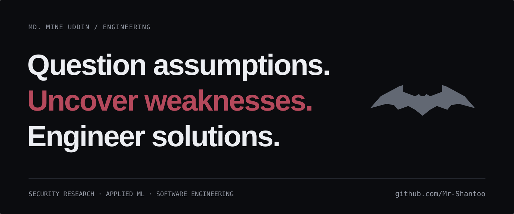

<picture>
  <source media="(prefers-color-scheme: dark)" srcset="assets/batman-hero-dark.svg">
  <source media="(prefers-color-scheme: light)" srcset="assets/batman-hero-light.svg">
  
</picture>

## About Me

I’m a final-year Computer Science and Engineering student at **United International University**, Dhaka, Bangladesh, graduating in **February 2027**. I investigate failures in APIs, software supply chains and edge systems, and build practical applications around what people need. My focus is cybersecurity, applied machine learning and dependable software.

## Case Files

### [SheSafe](https://github.com/saha-rinto-604/SheSafe)

A team-built safety prototype for incident reporting, location sharing and volunteer response. I contributed safe-route recommendations, danger-zone mapping and the volunteer-response workflow. Course project; not a deployed emergency service.

**Stack:** React Native, Expo, TypeScript, Node.js/Express, MySQL, WebSocket.

### [FinVision AI](https://github.com/Team-Anton/Finvision-3.0)

Student finance app with Bangla/Banglish expense input, receipt OCR, budgeting and shared expenses. I contributed as a member of Team Anton; financial records use local-first storage.

**Stack:** React Native, Expo, Redux Toolkit, Node.js/Express, MySQL, Claude API.

### [UniConnect](https://github.com/Mr-Shantoo/UniConnect)

University collaboration desktop app with study groups, shared notes and real-time messaging. I helped build the JavaFX application as a team course project.

**Stack:** Java, JavaFX, MySQL, WebSocket, jBCrypt.

## Research & Investigations

### Banking API Replay Defense

*Co-Lead Researcher · Submitted to the 5th ECCE (CUET) · Under review*

Evaluated layered replay defenses in a signed banking API testbed, identifying a delayed-replay weakness in success-only idempotency tracking.

### PackagePolice — Software Supply-Chain Security

*Technical Lead · Final Year Design Project · Research in progress*

Exploring ways to identify potentially malicious software packages and improve trust in open-source software ecosystems through security-focused research.

### Carbon-Aware Edge Intelligence — Sustainable Computing

*Technical Lead · Research in progress · Manuscript in preparation*

Investigating energy-efficient and environmentally responsible computing for intelligent water-quality monitoring systems.

Additional research · SheSafe HCI study

**SheSafe: Understanding User Needs for a Human-Centered Women's Safety Mobile Application**

*HCI term paper*

Used seven semi-structured interviews, inductive thematic analysis and a survey with 29 valid responses to inform a human-centered safety prototype, including trusted contacts and privacy controls.

## Technical Arsenal

| Area | Tools & focus |
| --- | --- |
| Languages | C, C++, Python, Java, JavaScript, TypeScript; learning Go |
| Frameworks & development | React Native, Expo, Node.js, Express, JavaFX, WebSocket, Redux Toolkit, HTML, CSS |
| Security & applied ML | API security, software supply-chain security, applied machine learning |
| Data & tooling | MySQL, SQLite, Redis-compatible stores, Git, GitHub, LaTeX |

## Recognition

- **HULT Prize · 2nd Runner-Up** — UIU on-campus round, 2024. Team Lead.
- **UIU CSE Project Show · 3rd Runner-Up** — SheSafe, Software Engineering Lab, Spring 2026.
- **UIU merit scholarship · 50%** — Fall 2023, Spring 2024 and Spring 2026.

## The Bat-Signal

Open to AI/ML internships, research collaboration and software projects. Send the signal.

[GitHub](https://github.com/Mr-Shantoo) · [LinkedIn](https://www.linkedin.com/in/md-mine-uddin/)
