<p align="center">
  
</p>

<p align="center">
  
</p>

Final-year CSE at UIU, graduating February 2027. I build systems that detect what's going wrong before it spreads: contaminated water, malicious packages. Currently working on IoT water-quality monitoring for the Padma River and leakage-controlled malicious-package detection for npm and PyPI.


## CASE FILES

Source for most of these is private while papers are unpublished.<br>
Each file states what is public and what is not.

### CASE 001: THE PADMA RIVER

```text
Threat:   Water contamination that nobody sees until it is
          downstream.
Evidence: Synthetic sensor dataset built with four SDV models
          compared (CTGAN, TVAE, CopulaGAN, GaussianCopula);
          CTGAN selected. Seeded from 25 real field
          measurements. Alert thresholds from the Bangladesh
          DoE ECR 2023.
Response: Decision-tree anomaly detector exported to C
          (emlearn) for ESP32 nodes, plus RCAS: a rule-based
          carbon-aware scheduler that defers non-critical
          transmissions to lower-carbon periods while
          preserving urgent alerts, battery limits and
          delivery deadlines.
Limits:   Evaluated on synthetic data and simulation (matched
          CI-aware vs CI-blind baselines, falsification tests,
          offline MILP benchmark). Field validation pending.
Role:     Technical Lead, 5-person team.
Status:   Final Year Project, in progress. Repo: private.
```

TODO(shanto): link casefile-padma repo once created.

### CASE 002: PACKAGEPOLICE

```text
Threat:   Malicious npm and PyPI packages that execute at
          install.
Evidence: Pipeline of secure package extraction, AST-based
          static analysis, dependency and install-script
          inspection, CodeBERT embeddings, XGBoost, SHAP
          explainability.
Response: Zero-execution, pre-installation detection,
          delivered as a VS Code extension. Evaluation audits
          for data leakage and acquisition-source bias:
          package-level deduplication, group-aware validation,
          source-controlled evaluation, cross-ecosystem
          generalization.
Limits:   Manuscript in preparation; results are not public
          yet.
Role:     Technical Lead, 5-person team.
Status:   Secondary FYP. Repo: private.
```

TODO(shanto): link casefile-packagepolice repo once created.

### CASE 003: SHESAFE

```text
Threat:   Women with no fast, trustworthy way to call for
          help.
Evidence: Mobile-first emergency platform: SOS alerting, live
          location sharing, danger-zone mapping, safe-route
          guidance.
Response: Community volunteer response: discovery and
          acceptance, live tracking, emergency chat, incident
          lifecycle management. React Native (Expo),
          TypeScript, Node/Express, MySQL, WebSocket.
Limits:   Course project; not a deployed service.
Role:     Contributor (safe-route recommendation, danger-zone
          mapping, volunteer response ecosystem).
Status:   3rd Runner-Up, UIU CSE Project Show, Spring 2026.
```

[Repository](https://github.com/saha-rinto-604/SheSafe)

### CASE 004: UNICONNECT

```text
Threat:   Students working in isolation across a campus.
Evidence: Desktop platform with real-time WebSocket messaging,
          study groups, collaborative notes with UniCoin
          rewards, reputation leaderboard, CGPA and tuition
          calculators.
Response: Java, JavaFX (Scene Builder), MySQL, bcrypt-secured
          onboarding, DAO-backed data layer.
Limits:   Course project (AOOP); desktop only.
Role:     Team Lead.
Status:   Complete, Feb 2025. Repo: public.
```

[Repository](https://github.com/Mr-Shantoo/UniConnect)

### CASE 005: FINVISION AI

```text
Threat:   Students with no clear picture of their own money.
Evidence: AI-powered financial assistant app for students.
Response: Mobile app built by Group 6 (Team Anton) for the MAD
          course.
Limits:   Course project.
Role:     Team member.
Status:   Submitted, MAD Spring 2026.
```

[Repository](https://github.com/Team-Anton/Finvision-3.0)


## UTILITY BELT

| Purpose | Tools |
| --- | --- |
| Detection & ML | Python, scikit-learn, XGBoost, SHAP, CodeBERT, SDV (CTGAN/TVAE/CopulaGAN/GaussianCopula), AST analysis |
| Field hardware | ESP32, TinyML, emlearn |
| Apps & backends | React Native (Expo), TypeScript, Node.js/Express, Java/JavaFX, MySQL, WebSocket |
| Languages | Python, Java, C/C++, TypeScript/JavaScript |

*Learning: Go.*

## COMMENDATIONS

- HULT Prize On-Campus Round 2024, UIU: 2nd Runner-Up (Team Lead)
- UIU CSE Project Show, Spring 2026: 3rd Runner-Up (SheSafe)
- UIU 50% merit scholarship: Fall 2023, Spring 2024, Spring 2026


## THE SIGNAL

[md.mineuddin121@gmail.com](mailto:md.mineuddin121@gmail.com) · [LinkedIn](https://www.linkedin.com/in/md-mine-uddin/)

Open to AI/ML internships and research collaboration.
