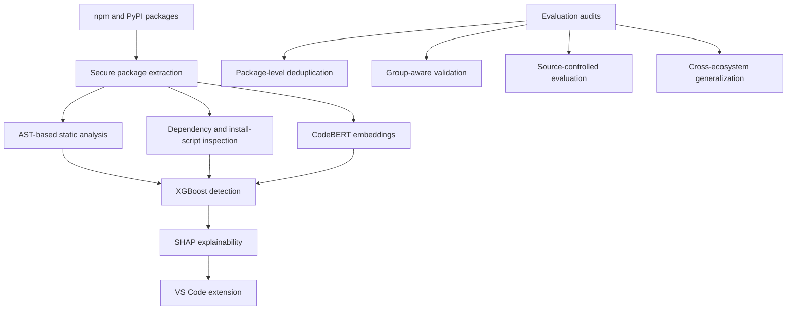

# CASE FILE: PACKAGEPOLICE

## Problem

Malicious npm and PyPI packages that execute at install.

## Pipeline

## Method

Use secure package extraction, AST-based static analysis, dependency and install-script inspection, CodeBERT embeddings, XGBoost and SHAP explainability. Detection is zero-execution and pre-installation, delivered as a VS Code extension.

Audit evaluation for data leakage and acquisition-source bias through package-level deduplication, group-aware validation, source-controlled evaluation and cross-ecosystem generalization.

TODO(shanto): confirm the pipeline diagram and add a supervisor-cleared method description before public release.

## What is public vs private

The project repository is private. The manuscript is in preparation; results are not public yet. This file is a template for a future public casefile.

TODO(shanto): list the artifacts cleared for public release and link each approved artifact.

TODO(shanto): state which implementation, data and manuscript materials must remain private after clearance review.

## Limits

The manuscript is in preparation; results are not public yet. Evaluation audits address data leakage and acquisition-source bias.

TODO(shanto): add supervisor-cleared limitations of the detection method and evaluation scope.

## Status

Secondary FYP. Repository: private.

TODO(shanto): update repository visibility and public casefile link after release clearance.
