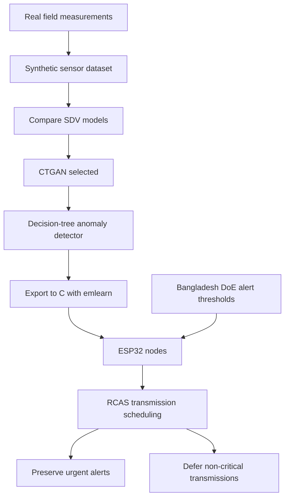

# CASE FILE: THE PADMA RIVER

## Problem

Water contamination that nobody sees until it is downstream.

## Pipeline

## Method

Compare CTGAN, TVAE, CopulaGAN and GaussianCopula for synthetic sensor data seeded from real field measurements; CTGAN was selected. Export a decision-tree anomaly detector to C with emlearn for ESP32 nodes.

RCAS is a rule-based carbon-aware scheduler. It defers non-critical transmissions to lower-carbon periods while preserving urgent alerts, battery limits and delivery deadlines.

Evaluation uses synthetic data and simulation: matched CI-aware and CI-blind baselines, falsification tests and an offline MILP benchmark.

TODO(shanto): add a supervisor-cleared method description and approved source references before public release.

## What is public vs private

The project repository is private. This file is a template for a future public casefile.

TODO(shanto): list the artifacts cleared for public release and link each approved artifact.

TODO(shanto): state which implementation, data and manuscript materials must remain private after clearance review.

## Limits

Evaluation is limited to synthetic data and simulation. Field validation is pending.

TODO(shanto): add supervisor-cleared assumptions and limits on transferring simulation findings to field conditions.

## Status

Green Computing Coursework, in progress. Repository: private.

TODO(shanto): update repository visibility and public casefile link after release clearance.
